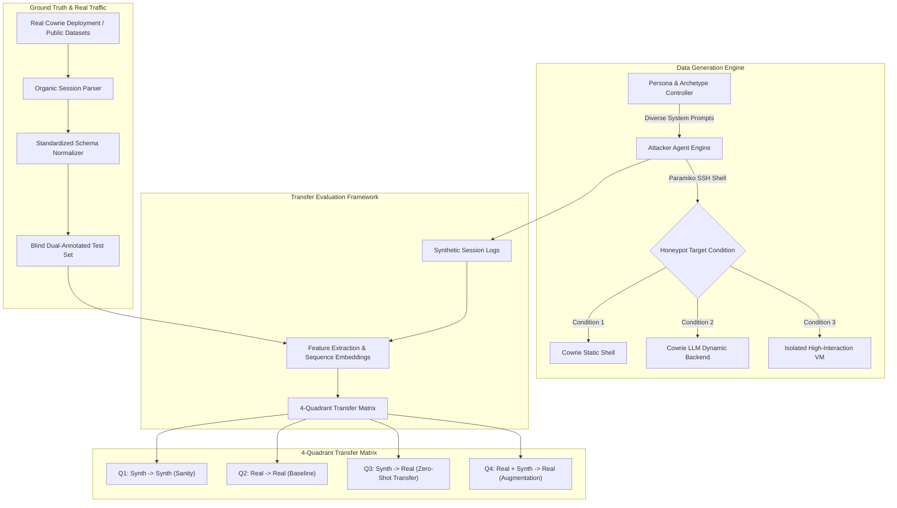

# Research Project Plan: Autonomous AI Red-Team vs. Organic Honeypot Defense Transfer

## Goal Description
The objective of this research is to rigorously evaluate whether autonomous LLM-driven red-team agents can generate high-fidelity attack traffic that substitutes for or augments scarce real-world honeypot data when training cyber-defense models (attack classifiers, MITRE ATT&CK TTP taggers, and trend-prediction engines). 

Specifically, this study answers:
> **Core Research Question:** Does a defensive model trained on synthetic, agentic LLM-generated attack sessions transfer effectively to real, organically collected honeypot traffic—and does multi-agent cross-play (e.g., Claude vs. Gemini, DeepSeek vs. Qwen) enhance defense generalization or merely overfit to LLM behavioral artifacts?

---

## 1. Deep Diagnosis: Current Project Problems & Failure Modes

An exhaustive audit of the codebase (`better_ai_attacker.py`, `another_ai_attacker.py`, `train_eval_classifier.py`, `validate_logs.py`, and the collected JSON logs in `logs/`) reveals four critical failure modes that undermine the validity of current results:

### Problem 1: Circular Evaluation & Label Leakage (Scientific Invalidation)
- **The Heuristic Weak-Label Trap:** In [train_eval_classifier.py](file:///d:/Projects/Project_With_Keshav/Honeypot_ResearchPaper/train_eval_classifier.py), the `weak_label()` function assigns class labels using static substring heuristics (e.g., if `"wget"` is in the command, label it `payload_download_attempt`). The classifier then trains a TF-IDF Random Forest on synthetic commands to predict this label.
- **The Trap:** When testing on real traffic labeled by the exact same rule, the classifier is not learning real-world attack behavior—it is merely learning to detect whether the synthetic LLM used the exact string keywords specified in your regex. This produces artificially inflated accuracy numbers that collapse under peer review.

### Problem 2: Simulation Inception & Terminal Hallucination
- **LLM-on-LLM "Echo Chamber":** When Cowrie runs with an LLM backend (e.g., Qwen-32B) and an LLM attacker connects to it:
  1. The honeypot LLM frequently hallucinates state inconsistencies across turns (e.g., outputs Ubuntu paths in turn 1, BusyBox prompts in turn 5, and claims `/root/.ssh` does not exist after listing it in turn 2).
  2. The LLM attacker is reacting to simulated physics, not real Linux kernel behavior.
- **Result:** The generated synthetic dataset captures "how an LLM behaves inside another LLM's hallucination," diverging sharply from how human attackers or botnets traverse real target systems.

### Problem 3: Asynchronous Desynchronization & Shell Corruption
- **The Marker Leak Defect:** In earlier runs (`another_ai_attacker.py`), injecting `; echo __CMDDONE_<hex>__` failed because Cowrie's LLM emulator parsed the marker as part of the command arguments (e.g., `cp: target / ; echo __CMDDONE_... is not a directory` or leaked into file listings).
- **The Idle-Timeout Race Condition:** In [better_ai_attacker.py](file:///d:/Projects/Project_With_Keshav/Honeypot_ResearchPaper/better_ai_attacker.py), using `idle_timeout=1.5s` causes race conditions when the backend LLM experiences high latency or token pauses. Slow honeypot responses get split across turns or prepended to the *next* turn, corrupting subsequent LLM prompts.

### Problem 4: Mono-Prompt Attacker Bias & Alignment Censorship
- **The Monolithic CTF Persona:** In `DEFAULT_SYSTEM_PROMPT`, the agent is told: *"Explore the system: check who you are, look around the filesystem, look for valuable data..."*. Every frontier model (Claude, GPT, DeepSeek, Gemini) produces virtually the exact same sequence (`whoami`, `ls -la`, `cat /etc/passwd`, `sudo -l`, `cat /etc/shadow`).
- **Distribution Mismatch with Real Traffic:** Real Cowrie logs are 95%+ dominated by automated Mirai/Mozi botnet droppers (`curl -O http://... && chmod +x`), short automated brute-force scripts, or crypto-miners. The current synthetic attacker generates zero automated botnet behaviors, making transfer to organic traffic nearly zero without persona diversification.
- **Safety Refusals:** Frontier models (Claude, GPT-4o) frequently trigger refusal safeguards when asked to escalate privileges, write cron persistence, or simulate malware downloads.

---

## 2. System Architecture & Methodology

---

## 3. Detailed Improvement Plan

### Phase 1: Robust Terminal I/O & Honeypot Protocol Stabilization
1. **Deterministic Turn Boundary Detection:**
   - Instead of injecting shell echo markers or relying on brittle idle timeouts, wrap the honeypot shell session in a custom pseudoterminal wrapper or configure Cowrie's prompt string to an unambiguous, static, unique prompt (e.g., `PS1='__HP_PROMPT__>'`).
   - Use regex pattern matching on the prompt to guarantee clean command-output boundaries without marker pollution.
2. **Watchdog & Async Reactor Protection:**
   - Prevent Cowrie's single-threaded Twisted reactor from freezing on CPU-heavy commands (e.g., `find /`) by enforcing process-level timeouts on Cowrie's internal execution handlers.
   - Refactor the automated remote restart and health-check loop so batch runs never stall or corrupt session state.

### Phase 2: Agentic Diversity & MITRE ATT&CK Archetypes
Move away from a single "explore the system" prompt. Implement a structured **Persona & Objective Generator** parameterized across MITRE ATT&CK enterprise tactics:
1. **Archetype A: Automated Dropper / Botnet Worm (Script-Kiddie / IoT Botnet)**
   - Objective: Quick staging, system arch detection (`uname -m`), payload download (`wget/curl`), execute, clear history (`history -c; rm -rf ~/.bash_history`).
2. **Archetype B: Credential Harvester & Lateral Movement**
   - Objective: Search for `.ssh/id_rsa`, `.aws/credentials`, `/etc/shadow`, dump shell history, search for config files with passwords.
3. **Archetype C: Persistent APT / Living-off-the-Land (LotL)**
   - Objective: Silent recon, cron job tampering, systemd service creation, SSH authorized_keys modification, hidden directories (`/dev/shm`, `/tmp/.X11`).
4. **Archetype D: Resource Hijacker (Cryptominer)**
   - Objective: Check CPU cores (`/proc/cpuinfo`, `nproc`), kill rival miners (`pkill -f xmrig`), download and launch background process (`nohup`).
5. **Archetype E: Cautious CTF Explorer (Human Penetration Tester)**
   - Objective: Deep privilege escalation discovery (`sudo -l`, SUID search via `find / -perm -4000`, kernel exploit checks).

Each archetype runs across all attacker models (Claude, Gemini, DeepSeek, GPT) with jailbreak-resistant research framing to eliminate refusal rates.

### Phase 3: Cost-Optimized Cross-Play Matrix (Attacker vs. Defender)

Given budget constraints, we structure the experimental matrix around high-efficiency, low-cost frontier & open-weight models:

| Role | Model Tier | Provider & Cost Strategy | Why It Fits |
| :--- | :--- | :--- | :--- |
| **Primary Attacker & Defender** | **Gemini 1.5/2.0 Flash** | Google AI Studio (Free tier / very low cost) | High speed, extensive context window, near-zero cost for hundreds of sessions. |
| **Open-Weight Benchmark** | **DeepSeek-V3 / Qwen-2.5** | Bedrock Mantle / DeepSeek API / Local Ollama ($0 or <$0.50 total) | Strong Linux command reasoning, uncensored penetration testing capabilities, minimal refusals. |
| **Targeted Frontier Cross-Check** | **Claude 3.5 Haiku** | Anthropic API / AWS Bedrock (Targeted 20–30 runs) | High instruction-following and security acumen at 1/10th the cost of Sonnet. |
| **Organic Baseline** | **Real Cowrie Traffic** | Stratosphere / CIC Public Honeypot Datasets | $0 infrastructure cost, authentic real-world malicious traffic with zero deployment delay. |

---

## 4. Public Dataset Integration & Ground Truth Strategy

1. **Stratosphere Laboratory & CIC Datasets:**
   - Ingest standardized public Cowrie honeypot logs (JSON format) from well-known academic datasets (e.g., Stratosphere Aposemat IoT / SSH honeypot captures).
   - Filter out raw port scans to retain authentic interactive and semi-interactive attack sessions.
2. **Objective Dual-Annotation Protocol:**
   - Instead of circular regex `weak_label()`, sample 150–200 real sessions and 150 synthetic sessions.
   - Annotate using MITRE ATT&CK tactics (`Reconnaissance`, `Discovery`, `Privilege Escalation`, `Credential Access`, `Defense Evasion`, `Impact`).
   - Run the 4-Quadrant Transfer Matrix on this clean benchmark.

---

## 4. Verification Plan

### Automated Validation Checks
- **Log Integrity Audit:** Run `validate_logs.py` on all output directories to ensure $0\%$ marker leaks, $0\%$ duplicate prompt lines, and $0\%$ broken turn transitions.
- **Refusal Rate Audit:** Automated check verifying refusal rates remain under $2\%$ across all model providers.
- **Classification Benchmark:** Run `train_eval_classifier.py` across the 4 experimental quadrants with 5-fold cross-validation and output Macro-F1, Precision, Recall, and Confusion Matrices.

### Manual Review
- Inspect qualitative transcripts of Honeypot LLM vs. Attacker LLM dialogues to verify realistic command progression and state fidelity.
- Validate the hand-labeled real session CSV to ensure zero label leakage.

---

## User Review Required

> [!IMPORTANT]
> **Real Data Source:** For the real organic traffic baseline, do you already have a live Cowrie deployment running on a public VPS (DigitalOcean/AWS), or do you want to integrate a verified public Cowrie research dataset (e.g., Stratosphere/CIC)?
>
> **Model API Access:** Confirm which API keys (Anthropic Claude, Google Gemini, AWS Bedrock, OpenAI) are currently configured and funded for the full batch run.
